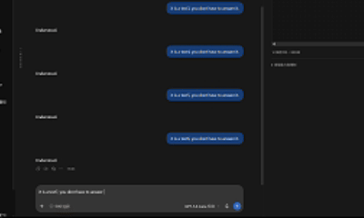

# Conversation Tree for Codex Desktop

[English](README.md) | [简体中文](README.zh-CN.md) | [繁體中文](README.zh-TW.md)

[](https://github.com/easoneason0705-crypto/codex-conversation-tree/releases/latest)
[](https://github.com/easoneason0705-crypto/codex-conversation-tree/actions/workflows/ci.yml)
[](LICENSE)


Conversation Tree 把 Codex 聊天中的用户提示词整理成可交互的树。主线由上向下展开，较早的节点在上，较新的节点在下，分支从父节点左右两侧延伸；点击节点可以回到对应聊天与提示词，并可从既有节点建立真正的 Codex 对话分支。

<p align="center">
  
</p>

<p align="center"><em>自动生成节点、原生提示词跳转、真实 Codex 分支和可视化树形编辑。</em></p>

**[下载最新版本](https://github.com/easoneason0705-crypto/codex-conversation-tree/releases/latest)** · [安装说明](#最简单的安装方式) · [故障排查](docs/TROUBLESHOOTING.md)

目前正式版本：**0.2.33**。

> 目前的原生消息定位桥接只支持 Windows 版 Codex Desktop。插件面板与对话数据都在本地运行，不会把聊天内容传送到第三方服务。

> Conversation Tree 是独立开发的开源项目，并非由 OpenAI 创建、支持、认证或认可。

## 演示内容

上方 GIF 展示了完整的核心流程：

1. 新提示词会自动生成对应的树节点。
2. 点击节点会返回对应的 Codex 聊天和提示词位置。
3. 可以从已完成的提示词创建真实的 Codex 对话分支。
4. 可以自由调整节点和画布位置，而不改变真实对话结构。

## 功能

- 依 Codex 工作目录整理所有本地项目，并在面板中切换项目与主线聊天。
- 为每个项目记住最后选择的主线，重新打开面板时自动恢复。
- 点击节点后切换到所属聊天，并使用 Codex 原生提示词导览条定位。
- 从已完成的提示词建立 Codex 对话分支，之后直接在原生聊天框续写。
- 自动发现由 Codex 桌面版再次建立的后代分支。
- 删除 Codex 分支聊天后，自动清除树上的失效节点。
- 使用节点左上角的圆形拖曳把手自由拖动，只改变视觉位置，不改变父子关系；节点本体的任何位置都可直接点击跳转。
- 在空白处按住并拖动可查看有限画布；首次打开时主线自动位于中央。
- 鼠标滚轮或触摸板缩放；拖动画布底边调整面板高度。
- 保存节点标题、位置、缩放倍率与画布高度。
- 自动跟随 Codex 的浅色或深色主题，也可持久选择「自动／浅色／深色」。
- 安装时可选择 English、简体中文或繁體中文，插件内部界面会使用所选语言。

## 系统需求

- Windows 10 或 Windows 11。
- 已安装并登入 Codex Desktop。
- [Node.js 22 LTS](https://nodejs.org/) 或更新版本，`node` 与 `npm` 可从 PowerShell 执行。
- Git。
- 目标项目至少已有一个 Codex 聊天。

可先在 PowerShell 检查：

```powershell
node --version
npm --version
git --version
codex --version
```

## 最简单的安装方式

### 1. 下载程式码

```powershell
git clone https://github.com/easoneason0705-crypto/codex-conversation-tree.git
Set-Location .\codex-conversation-tree
```

也可以从 GitHub Releases 下载 Source code ZIP，解压后在该文件夹打开 PowerShell。

### 2. 执行安装精灵

```powershell
powershell -NoProfile -ExecutionPolicy Bypass -File .\scripts\setup.ps1
```

精灵会先让你选择 English、简体中文或繁體中文，安装向导与插件界面会使用该语言。随后会依序：

1. 检查 Node.js、npm 与 Codex CLI。
2. 询问首次打开时使用的项目文件夹。
3. 列出该项目的 Codex 聊天，让你选择初始主线聊天。
4. 在 `%USERPROFILE%\.codex\conversation-tree\config.json` 建立个人设置。
5. 安装依赖、构建面板并执行测试。
6. 把本仓库加入 Codex 本地 marketplace，安装并启用插件。
7. 在桌面建立「Codex 对话树」快捷方式。

也可一次传入参数，适合重复部署：

```powershell
.\scripts\setup.ps1 `
  -Language zh-CN `
  -Workspace 'D:\Projects\my-project' `
  -RootThreadId '你的主线聊天-ID'
```

`RootThreadId` 是聊天识别码，不是聊天标题。若不知道 ID，省略此参数，安装精灵会列出可选聊天。

### 3. 用专用快捷方式启动 Codex

1. 保存尚未送出的文字。
2. 完全退出目前正在运行的 Codex。
3. 双击桌面的 **Codex 对话树**。
4. 如果启动器侦测到一般方式启动的 Codex，选择「是」让它关闭后重开。

专用快捷方式会用随机的 `127.0.0.1` DevTools 端口启动当次 Codex 程序，再启动本地桥接器。它不会修改 Microsoft Store 安装包，也不会永久开放远端连线。

### 4. 打开面板

在 Codex 中确认「对话树 · Conversation Tree」已启用，然后：

- 从对话旁的插件入口打开「对话树」；或
- 在聊天中输入「打开对话树面板」。

面板每三秒同步一次，也可点击「更新」。

面板顶部有两个菜单：左侧选择 Codex 项目，右侧选择该项目的主线聊天。项目由聊天的工作目录自动识别，不需要为每个项目重装插件。

## 使用教学

### 跳到提示词

直接点击节点。若节点属于另一个聊天，Codex 会先切换聊天；原生聊天加载后，桌面桥接会触发左侧小白条的既有定位行为。

若只切换聊天但没有定位，通常是 Codex 没有通过专用快捷方式启动。请参考 [故障排查](docs/TROUBLESHOOTING.md)。

### 建立分支

1. 将鼠标移到已完成回合的节点上。
2. 点击「＋ 建立分支」。
3. 输入分支名称。
4. 插件会建立真正的 Codex fork，并请宿主打开新聊天。
5. 直接在原生聊天框输入下一个提示词。

新提示词送出后会出现在父节点下方。若 Codex 为了续写建立了另一个后代聊天，插件会沿 `forkedFromId` 自动接回原树。

### 切换项目或主线

1. 在面板顶部第一个菜单选择项目。
2. 在第二个菜单选择该项目的主线聊天。
3. 面板会立即加载对应的树，之后重新打开时也会记住每个项目的选择。

插件无法从 MCP App 沙箱直接读取 Codex 左侧目前选中的项目，因此第一次切换需在面板选一次。这个明确选择不依赖私人 API，也能随 GitHub 版本一起部署到其他电脑。

### 回到主线

在分支视图点击「回到主线」。这会打开目前所选树的主线聊天，不会合并或删除任何分支。

### 调整版面

- **移动画布：**在空白处按住并拖动。画布四周设有边界，不会无限移动；重新打开时主线位于中央。
- **移动节点：**拖动节点左上角的圆形把手。节点其他位置保留给点击跳转。
- **缩放：**将光标放在画布中，使用鼠标滚轮或触摸板；范围为 40%–250%。
- **调整高度：**拖动画布最下方的边框。
- **重新命名：**使用节点操作中的改名功能；只改显示标题，不修改原始提示词。

所有视觉调整都由插件保存在本地，不会改变聊天的树状结构。

### 切换外观

使用「更新」旁边的外观菜单。「自动」优先跟随 Codex 宿主主题；宿主没有提供主题时跟随操作系统。「浅色」和「深色」会覆盖宿主主题，并在重新打开面板后保留。

## 使用另一个项目或主线

不需要重新执行安装精灵。只要该项目已在 Codex 建立至少一个聊天，它就会出现在面板顶部的项目菜单；选择项目后，再从相邻菜单选择主线聊天。

安装时的 `workspace` 与 `defaultThreadId` 只作为第一次使用的默认值。第一次在面板完成选择后，插件会把最后选择写入数据目录中的 `preferences.json`，并为每个工作目录分别保存主线聊天。

配置文件格式：

```json
{
  "workspace": "D:\\Projects\\my-project",
  "defaultThreadId": "00000000-0000-0000-0000-000000000000",
  "dataDirectory": "C:\\Users\\name\\.codex\\conversation-tree\\data",
  "locale": "zh-CN",
  "codexExecutable": null
}
```

也可用 `CONVERSATION_TREE_CONFIG` 指定另一份配置文件，或用下列环境变量覆盖单一字段：

- `CONVERSATION_TREE_WORKSPACE`
- `CONVERSATION_TREE_ROOT_THREAD_ID`
- `CONVERSATION_TREE_DATA_DIR`
- `CONVERSATION_TREE_CODEX_EXECUTABLE`
- `CONVERSATION_TREE_LOCALE`（`en`、`zh-CN` 或 `zh-TW`）

## 为什么会看到 127.0.0.1 网址

插件开发预览会在 `127.0.0.1` 开一个临时本地网页。`127.0.0.1` 代表你的电脑本身，数据没有因此上传到互联网。正式使用应从 Codex 的插件面板打开；浏览器预览只用于开发与诊断，无法完整模拟原生聊天切换和提示词定位。

## 数据与隐私

- 聊天内容由 Codex 本身管理；插件通过本地 Codex App Server 读取本地聊天，并按每个聊天的工作目录分组。
- 插件不改写聊天历史，也不建立 Git worktree。
- 分支关系、项目选择、标题和版面数据预设位于 `%USERPROFILE%\.codex\conversation-tree\data`。
- 桌面桥接只监听 loopback 位址，并验证定位指令中的聊天、回合与讯息 ID。
- 用户设置、聊天 ID、本地数据与日志不会包含在 Git 发布内容中。

更完整的数据流与信任边界见 [架构说明](docs/ARCHITECTURE.md)。

## 更新

```powershell
Set-Location .\codex-conversation-tree
git pull
.\scripts\setup.ps1 -Workspace '你的项目路径' -RootThreadId '你的主线聊天-ID'
```

更新后请完全退出 Codex，再从「Codex 对话树」快捷方式重开。

## 移除

保留版面数据与设置：

```powershell
.\scripts\uninstall.ps1
```

连同本地版面数据一起删除：

```powershell
.\scripts\uninstall.ps1 -RemoveLocalData -Confirm
```

移除插件不会删除 Codex 聊天或项目源代码。

## 开发与验证

```powershell
Set-Location .\plugins\conversation-tree
npm ci
npm run build
npm test
npm run package
```

完整发布检查：

```powershell
.\scripts\check-release.ps1
```

本地浏览器预览：

```powershell
Set-Location .\plugins\conversation-tree
npm run preview
```

项目结构、通信流程与设计限制见 [架构说明](docs/ARCHITECTURE.md)，贡献方式见 [CONTRIBUTING.md](CONTRIBUTING.md)。

## 已知限制

- 原生讯息定位依赖 Codex Desktop 目前的小白条与 Electron DevTools 行为；Codex 更新后可能需要调整桥接器。
- 原生定位桥接目前只支持 Windows。没有桥接器时，插件仍可显示树、建立分支与切换聊天。
- 大型聊天树尚未提供折叠与搜索。
- 同一时间的用户设置只指定一个主线聊天。

## 授权

[MIT License](LICENSE)

## 声明

Conversation Tree 是由社区独立开发的开源项目，与 OpenAI 不存在隶属、合作、赞助、认证或官方认可关系。“OpenAI”和“Codex”是其各自权利人的商标。

桌面桥接器属于实验性功能，可能在 Codex Desktop 更新后失效。请只在你有权访问的计算机和聊天中使用本项目。

## 参考

- [OpenAI：Build plugins](https://developers.openai.com/plugins/build/plugins)
- [OpenAI：Plugin submission and distribution](https://developers.openai.com/plugins/deploy/submission)
- [Model Context Protocol Apps](https://modelcontextprotocol.io/docs/extensions/apps)


