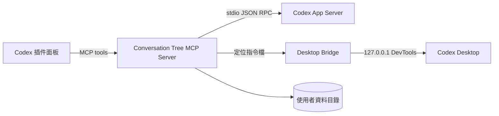

# 架構說明

Conversation Tree 由三個本機元件組成。

## 插件面板

面板是打包進 MCP 資源的單一 HTML 文件。它呈現節點與連線，處理拖動、縮放、畫布高度與節點操作。面板只提交節點 ID；聊天、回合與訊息 ID 都由伺服器重新從當前快照解析，避免前端要求定位到樹外的聊天。

## MCP Server

`plugins/conversation-tree/src/server.mjs` 提供 `tree_open`、項目清單、主線選擇、刷新、分支、定位和重新命名等操作。它透過獨立的 `codex app-server --listen stdio://` 程序讀取聊天，不讀寫 Codex 的內部資料庫。歷史檔變更時會使用新連線，避免 App Server 快照停留在舊狀態。

## 多項目選擇

MCP App 目前不會向插件公開 Codex 左側正在查看的項目或聊天 ID。插件因此從 `thread/list` 取得聊天，以 `thread/read` 回傳的 `cwd` 作為項目鍵，並在面板提供明確的「項目／主線聊天」選單。

聊天清單會先按 ID 去重；已記錄的插件分支以及帶有原生父聊天欄位的聊天不會列為主線。`preferences.json` 保存全域最後主線與每個工作目錄最後選擇的主線。`defaultThreadId` 只在尚未建立偏好時作為初始後備值。

## 分支模型

主線節點來自面板目前選擇的根聊天。插件建立的分支會保存分支聊天、根聊天、父聊天、父節點和邊界回合 ID。

Codex 桌面版後續建立的聊天會用 `forkedFromId` 和共同回合 ID 重新接回樹。插件不以聊天名稱或提示詞文字猜測父子關係。活動聊天清單是刪除同步的判定來源；新分支有短暫寬限，避免清單尚未更新時被誤刪。

## 原生訊息定位

Codex 的聊天渲染程序與 MCP App 面板可能屬於不同 WebContents，因此定位流程是：

1. 面板呼叫 `tree_reveal`。
2. MCP Server 重新驗證節點，寫入 `reveal-command.json`。
3. Desktop Bridge 透過本機 DevTools 連線把指令交給原生聊天頁面。
4. 注入腳本尋找 Codex 已有的提示詞導覽項目，觸發其 click。
5. Codex 自己完成歷史載入、捲動與高亮。

橋接器不修改 Codex 安裝檔。它只在由專用啟動器建立的當次程序中存在。

## 設定與資料目錄

預設設定檔是 `%USERPROFILE%\.codex\conversation-tree\config.json`，預設資料目錄是 `%USERPROFILE%\.codex\conversation-tree\data`。其中包含分支、每個項目的主線偏好、標題、介面儲存資料與橋接狀態，不屬於發佈套件。

## 安全邊界

- 項目分組只使用 `thread/read` 回傳的 `cwd`，不接受面板提供任意本機路徑。
- 對話、回合、訊息與 nonce 都需符合受限 ID 格式。
- 橋接埠只綁定 `127.0.0.1`，且每次啟動隨機選擇。
- 插件只允許對當前樹快照中的節點執行定位或分支。
- 寫入採臨時檔後 rename，避免部分寫入。
